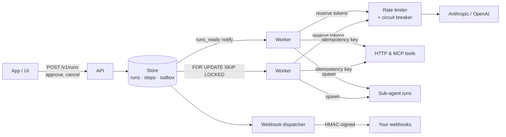

# Stepwise

**A durable runtime for AI agents, written in Go.** Agents run step by step, and every model call and tool call is saved before the next one starts. Workers can crash, providers can go down, humans can take days to approve a refund — the run picks up exactly where it stopped, never loses work, and never performs a side effect twice.

```
go run ./cmd/stepwise dev      # open http://localhost:8080 — no API keys, no database
```


---

## Proof: the chaos test

1,000 refund agents ran on 8 separate `stepwise worker` processes sharing one Postgres database while a worker was **killed with `SIGKILL` every ~250 ms** — 375 kills, no graceful shutdown — with 5% of tool calls and 5% of model calls failing on top. Every run needed a human approval before refunding.

| Check | Result |
| --- | --- |
| Runs completed | **1,000 / 1,000** |
| Runs lost or stuck | **0** |
| Refunds issued | **1,000** — exactly one per order |
| Orders refunded twice | **0** |
| Refund calls repeated after a crash, absorbed by idempotency keys | 38 |
| Step histories with gaps or duplicates | **0** |
| Model calls re-executed (the cost of being killed mid-call) | 13% |

Reproduce it against your own Postgres:

```bash
go run ./cmd/chaos -db "$DATABASE_URL" -runs 1000 -workers 8 -kill-every 250ms -latency 40ms -lease 1s
```

Without `-db`, the harness runs in one process with an in-memory store and simulates the kills. [Full report](docs/chaos-report.md). CI runs both on every push.

## Why this exists

Agent runs are long, flaky and expensive: thirty model calls, tool calls against real systems, sometimes a pause for a human. Most setups keep that state in memory. A deploy, an OOM or a provider outage at step 25 means starting over — paying for 25 model calls again and, worse, maybe refunding a customer twice.

Stepwise treats an agent run like a database transaction log:

- **Every step is persisted before the next starts.** After a crash, saved steps are replayed instead of re-executed; only the step in flight runs again.
- **Side effects are exactly-once.** Each tool call gets an idempotency key that never changes across retries or crashes.
- **Waiting is free.** A run waiting on a human or a sub-agent holds no worker and no memory; it can wait for days.
- **Providers are shared fairly.** A token-bucket rate limiter and a circuit breaker sit in front of every model call, so 50 workers don't stampede one API key.

## What it looks like

A refund agent, defined in JSON, with tools from an MCP server and a human approval gate:

```bash
curl -s localhost:8080/v1/runs -d '{
  "agent": {
    "model": "mock",
    "system": "You are a refund agent. Look up the order, check the policy, refund if eligible.",
    "tools": [{"type": "mcp", "url": "http://localhost:8080/demo/mcp"}],
    "require_approval": ["issue_refund"]
  },
  "input": "Earbuds arrived broken. order_id: ORD-1001, amount: 49.99",
  "webhook_url": "https://example.com/hooks/stepwise"
}'
```

The run calls `get_order`, then `check_refund_policy`, then asks to call `issue_refund` — and stops. It shows up in `GET /v1/approvals` and in the web UI, and a webhook fires. Approve it and the run continues:

```bash
curl -s -X POST localhost:8080/v1/runs/$RUN/steps/$STEP/approve -d '{"decided_by": "yash"}'
```

Use `"model": "claude-sonnet-4-5"` (with `ANTHROPIC_API_KEY`) or a `gpt-*` model (with `OPENAI_API_KEY`) for a real model; `mock` is a deterministic agent that costs nothing. More examples in [examples/](examples).

## Architecture



**One step of one run:**

1. A worker claims a runnable run and gets a **lease** plus a **fencing token**. A heartbeat keeps the lease alive.
2. It loads the saved steps and calls `decide()` — a pure function of saved state — to pick the next action: call the model, run a tool, wait, finish or fail.
3. Before a model call it checks the provider's circuit breaker and reserves tokens from the rate limiter. If either says *not now*, the run goes back to the queue with a delay — the worker is free for other runs.
4. It records "step started", performs the step, and saves the result. Every write carries the fencing token; a worker that lost its lease is rejected.
5. Repeat until the model gives a final answer, a human is needed, or a limit is hit.

Details and trade-offs: [docs/DESIGN.md](docs/DESIGN.md).

## Features

| | |
| --- | --- |
| **Crash-safe execution** | Steps persisted before the next starts; replay on resume; leases + fencing tokens against zombie workers |
| **Exactly-once side effects** | Stable idempotency key per tool call (`Idempotency-Key` header for HTTP tools, `_meta` for MCP) |
| **Tools** | HTTP tools, any **MCP** server (Streamable HTTP; tools discovered with `tools/list`), and sub-agents; per-tool `headers` with `${STEPWISE_SECRET_*}` references for auth |
| **Conversations** | `POST /v1/runs/{id}/messages` continues a completed run: one run = one conversation, one audit trail, one budget; `max_turns` applies per message |
| **Human-in-the-loop** | `require_approval` per tool; approve or reject via API or UI; rejections are shown to the model so it can adapt; `approval_timeout` (e.g. `"24h"`) rejects calls nobody answered |
| **Sub-agents** | A tool can be another agent; children run in parallel as durable runs; tokens roll up to the parent's budget |
| **Self-healing triage** | When a run fails, a triage agent reads it, records a diagnosis, and asks (with approval) to retry. Provider outages are diagnosed by rules with no LLM call, and at most 10 triage runs are active at once, so a burst of failures can't start hundreds |
| **Provider resilience** | Token-bucket rate limits (RPM + TPM) shared by every worker through Redis, circuit breaker per provider, retries with jittered exponential backoff, `Retry-After` support |
| **Structured output** | `response_schema` (JSON Schema) on the agent: the final answer is JSON matching it, via the provider's native structured-output mode; anything else fails the run instead of returning bad JSON |
| **Budgets and limits** | Per-run token budget and `max_turns`; per-tool call limits (`"limits": {"issue_refund": 1}`); monthly token limit |
| **Webhooks** | Transactional outbox; HMAC-SHA256 signatures with timestamps; retries; dead-lettering |
| **Observability** | OpenTelemetry traces (one trace per run: the trace ID *is* the run ID; `gen_ai.*` attributes; `traceparent` sent to tools); Prometheus metrics; JSON logs; live updates over SSE |
| **Web UI** | Run list, step timeline with re-execution badges, approvals, cancel/retry — embedded, no build step |
| **Gateway** | OpenAI-compatible `/v1/chat/completions` passthrough (streaming included) for plain LLM calls |
| **Small dependency set** | Standard library plus `pgx` (Postgres), `go-redis` and the OpenTelemetry SDK |

## Quick start

```bash
git clone https://github.com/valayash/stepwise && cd stepwise
go run ./cmd/stepwise dev
```

Open http://localhost:8080 → **New run** → **Start**. Approve the refund when it asks.

**The full production setup** — Postgres, Redis, Jaeger, Prometheus, one API process, two workers and the demo shop:

```bash
docker compose up --build
./examples/demo.sh   # with STEPWISE_SHOP_URL=http://shop:8090/mcp
```

| | |
| --- | --- |
| http://localhost:8080 | Stepwise UI and API |
| http://localhost:16686 | Jaeger — paste a run ID to open its trace |
| http://localhost:9090 | Prometheus — API and every worker are scraped |

Scale workers with `docker compose up --scale worker=5`. CI boots this exact stack on every push, runs the refund agent through it, and checks the trace landed in Jaeger.

Or run the binary yourself against any Postgres 14+:

```bash
docker run -d --name pg -e POSTGRES_PASSWORD=pw -p 5432:5432 postgres:16
export STEPWISE_DATABASE_URL="postgres://postgres:pw@localhost:5432/postgres?sslmode=disable"
go run ./cmd/stepwise serve            # API + UI + workers; migrations run on start
go run ./cmd/stepwise worker           # in another terminal: more workers, same database
```

| Command | What it runs |
| --- | --- |
| `stepwise dev` | API, UI, workers, webhooks and the demo shop in one process, in memory |
| `stepwise serve` | API + workers + webhooks against Postgres (`STEPWISE_DATABASE_URL`) |
| `stepwise api` / `worker` / `webhooks` | Run each service separately; they share only Postgres. Scale any of them horizontally |
| `stepwise migrate` | Apply database migrations |
| `stepwise demo-shop` | The demo shop MCP server on its own |
| `stepwise healthcheck` | Exit 0 if the local server is healthy (for containers without curl) |

## API

| Method | Path | |
| --- | --- | --- |
| `POST` | `/v1/runs` | Start a run. `Idempotency-Key` header (or field) dedupes retries of the request itself |
| `GET` | `/v1/runs?status=&parent_run_id=&limit=` | List runs |
| `GET` | `/v1/runs/{id}` | Run, its steps and its sub-agents |
| `GET` | `/v1/runs/{id}/events` | Live updates (server-sent events) until the run ends |
| `POST` | `/v1/runs/{id}/steps/{step}/approve` · `/reject` | Decide a pending tool call (`note`, `decided_by`) |
| `POST` | `/v1/runs/{id}/cancel` · `/retry` | Cancel (cascades to sub-agents) · retry a failed run |
| `POST` | `/v1/runs/{id}/kill` | Simulate a worker crash mid-run (dev/serve only); the run resumes from its saved steps |
| `POST` | `/v1/runs/{id}/messages` | Continue a completed run as a conversation (`content`); the next reply arrives like any run's output |
| `GET` | `/v1/approvals` | Inbox of every tool call waiting for a human |
| `GET` | `/v1/usage` | This month's runs and tokens, and the monthly limit |
| `GET` | `/v1/runs/{id}/deliveries` | Webhook delivery log |
| `POST` | `/v1/chat/completions` | OpenAI-compatible passthrough |
| `GET` | `/metrics` · `/healthz` · `/readyz` | Operations |

## Configuration

| Variable | Default | |
| --- | --- | --- |
| `STEPWISE_ADDR` | `:8080` | Listen address |
| `STEPWISE_DATABASE_URL` | — | Postgres; empty only allowed in `dev` |
| `STEPWISE_API_TOKEN` | — | Require `Authorization: Bearer` on `/v1` |
| `ANTHROPIC_API_KEY` · `OPENAI_API_KEY` | — | Enable `claude-*` · `gpt-*`/`o*` models |
| `STEPWISE_WORKERS` | `8` | Concurrent runs per process |
| `STEPWISE_LEASE` | `30s` | Lease length; a dead worker's runs resume after this |
| `STEPWISE_MAX_ATTEMPTS` | `6` | Tries per step before a run fails |
| `STEPWISE_RATE_LIMITS` | — | e.g. `claude-=rpm:50,tpm:40000;gpt-=rpm:500` |
| `STEPWISE_REDIS_URL` | — | Share rate limits across every worker process |
| `OTEL_EXPORTER_OTLP_ENDPOINT` | — | Send traces, e.g. `http://jaeger:4318` |
| `STEPWISE_METRICS_ADDR` | — | Metrics + health port for worker-only processes |
| `STEPWISE_DEMO_SHOP_URL` | — | Shop URL the UI's example uses (reachable by workers) |
| `STEPWISE_ALLOWED_TOOL_HOSTS` | any | Comma-separated hosts tools may call (`api.shop.com,*.shop.com`), redirects included; set it whenever you run agent specs you don't fully control |
| `STEPWISE_RETENTION_DAYS` | keep | Delete finished runs (with sub-agents, steps and webhook deliveries) older than this many days |
| `STEPWISE_MONTHLY_TOKEN_LIMIT` | — | Refuse new runs (HTTP 429) once this month's tokens reach it; see `GET /v1/usage` |
| `STEPWISE_WEBHOOK_SECRET` | — | HMAC key for webhook signatures |
| `STEPWISE_SECRET_*` | — | Secrets tool `headers` may reference, e.g. `"Authorization": "Bearer ${STEPWISE_SECRET_SHOP}"`; resolved per call, only sent to the tool's own host, never stored |
| `STEPWISE_TRIAGE` · `_MODEL` · `_AUTO_RETRY` | `true` · auto · `false` | Self-healing triage agent |
| `STEPWISE_MOCK_LATENCY` · `_FAIL_RATE` | `0` | Make the mock model slow or flaky |

## How it compares

| | Stepwise | Temporal | LangGraph checkpoints | AWS Bedrock AgentCore |
| --- | --- | --- | --- | --- |
| What it is | Agent runtime | General durable execution | Agent framework with saved state | Managed agent platform |
| Run it | One Go binary + Postgres | Temporal cluster + workers | Inside your Python app | AWS-managed |
| LLM-aware limits | Token-bucket TPM/RPM, budgets, circuit breaker | Build it yourself | Build it yourself | Managed by AWS |
| Agents defined as | JSON spec (model, tools, approvals) | Code with determinism rules | Python graph | AWS config + code |

Stepwise is a focused, self-hosted engine for one job — running tool-using agents durably — rather than a general workflow platform.

## Testing

Step-by-step checks for every feature, from no setup to production-like: [docs/TESTING.md](docs/TESTING.md).

```bash
make test                                   # unit + integration tests, race detector on
STEPWISE_TEST_DATABASE_URL=... make test    # also runs the Postgres store tests
make chaos                                  # in-process crash test
DATABASE_URL=... make chaos-pg              # multi-process SIGKILL test on Postgres
```

The in-memory and Postgres stores share one **conformance suite** (leases, fencing, approvals, sub-agents, outbox, concurrent claims) and both pass it, so they implement identical semantics. Engine tests cover the refund flow, crash-after-side-effect, transient retries, exhaustion → triage → approved retry, sub-agents, budgets, cancellation, rate limiting, graceful shutdown and a model inventing tools.

## Status and roadmap

- [x] Engine, in-memory store, API, UI, webhooks, MCP, triage
- [x] Postgres store (`pgx`, embedded migrations, `SKIP LOCKED`, `LISTEN/NOTIFY` in transactions), passing the conformance suite
- [x] Multi-process `SIGKILL` chaos test on Postgres, in CI
- [x] Redis-backed rate limiter shared by the whole fleet
- [x] OpenTelemetry traces (one trace per run, a span per model and tool call)
- [x] Docker Compose stack, booted and exercised in CI
- [ ] Stream model tokens live into durable runs
- [ ] Time-partitioned steps table for very large histories

## Layout

```
cmd/stepwise        the binary: dev, serve, api, worker, migrate, demo-shop
cmd/chaos           crash/fault-injection harness
internal/engine     workers, decide(), model + tool execution, triage agent
internal/store      Store interface, conformance suite, memory + Postgres stores
internal/provider   Anthropic, OpenAI and mock adapters; tool calling; streaming
internal/tools      HTTP/MCP/built-in tool runner; spec validation
internal/mcp        MCP client and server (Streamable HTTP)
internal/ratelimit  token-bucket limiter: local and Redis (atomic Lua)
internal/telemetry  OpenTelemetry setup; trace ID = run ID
internal/breaker    circuit breaker + backoff
internal/webhook    outbox dispatcher, HMAC signing
internal/api        REST API, SSE, embedded UI
internal/gateway    OpenAI-compatible passthrough
internal/demo       demo shop (MCP) with idempotent refunds
```

## License

MIT
